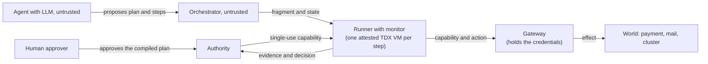

# Confining LLM agents at the effect level

Code and recorded data for the master thesis "Trustworthy LLM Judges. Detecting Embedded
Judgment Manipulation and Anchoring Verdicts with Confidential Computing" by Jan-Frederik
Felsch. The repository holds a research prototype in which a language model may propose
actions but cannot cause an effect on its own authority.

An agent that reads untrusted content can be talked into the wrong action. This work does not
try to detect that. It stops an action from taking effect unless it matches the plan a human
approved. The model may only propose a plan. A human approves the compiled plan before any
step runs. Every step is then checked by an independent reference monitor, and the real
credentials for payments and other sensitive operations stay inside a gateway, where neither
the agent nor its runner can read them.



The prototype is built as a ladder. Each version adds one mechanism, and every version keeps
the tests of the one below it.

| Version | Mechanism added |
|---|---|
| V0 | Deterministic monitor over an approved action sequence |
| V1 | Tool identity, argument constraints, signed approval, hash-chained audit |
| V2 | Cross-step bindings and facts that only trusted results can produce |
| V3 | One single-use runner per step, an Authority, single-use capability tokens, a gateway |
| V4 | The same protocol on an OS process, a hardened container or a Kubernetes pod |
| V5 | Each step runs in its own attested Intel TDX VM (Confidential Containers on GKE) |

Around the ladder sit a WebAuthn approval gate (`booking_approval`), a live world with real
counterparties in test mode (`booking_live`), a demo with a dashboard (`booking_demo`) and a
chat front end (`ui`).

## Choose how to start

| Path | You need | Cost | What you get |
|---|---|---|---|
| 1. Offline | Python 3.10 or newer | none | Full test suite, the experiments of V0 to V2.1, the thesis tables, a demo with a scripted agent |
| 2. Local with a model | A model API key, optionally a Duffel test token, optionally Docker | model usage | The demo and a chat UI with a real model and a human approval step, no cluster |
| 3. Own cluster | A Google Cloud project with billing and C3 TDX quota, `gcloud`, `kubectl`, `helm`, `docker` | cloud cost, see below | The attested V5 chain on Confidential Containers |

The repository is meant to be inspected and started. It is not meant to reproduce the exact
measurement of the thesis. See [Data](#data) for what that would need.

## Path 1: offline

```bash
python3 -m venv .venv && . .venv/bin/activate
pip install -r requirements-offline.txt
```

The V0 to V2 monitors and their tests use the standard library only. `run_v2.py` and
`run_v2_1.py` also record a run manifest through `booking_v4.manifest`, which needs
`cryptography` and the packages `booking_v3` and `booking_v4`. From V3 on the code needs
`cryptography`, `PyYAML`, `requests` and `pyasn1`, which the file pins. `ENVIRONMENT.md` lists
the versions, the evaluated configuration and how each result directory is regenerated.

Run the whole suite, or a part of it:

```bash
python3 verify.py             # every test module, with a diff against the previous run
python3 verify.py --quick     # skips the slow service and durable modules
python3 verify.py -k booking_v5   # only modules whose name contains the text
python3 verify.py --list      # show what would run
```

A full run takes a few minutes. Some tests skip on purpose, and each skip says why. They need
OPA 0.68.0, Docker or a cluster, or they pin digests of the measured freeze. Those digests
cannot hold for the sanitised data in this repository, so 22 tests skip with that reason.

Run the experiments of the first three versions. Each writes a result directory next to the
script:

```bash
python3 run.py        # V0
python3 run_v1.py     # V1.2
python3 run_v2.py     # V2
python3 run_v2_1.py   # V2.1, including the lying-world scenarios (rewrites results_v2_1)
```

Regenerate the thesis tables from the recorded data:

```bash
python3 -m booking_v5.report_v5 --out tables --no-readme \
    --price-per-hour 0.2117 \
    --price-source "GCE list price c3-standard-4, europe-west4, retrieved 2026-10-01"
```

Give `--out`, because the default points to a thesis checkout beside the repository. The
command also rewrites `results_v5/demo/llm-summary.json`. The eleven `.tex` files it writes are
byte-identical to the tables in the thesis.

Run the demo with the mock world and a scripted agent. It shows one injected e-mail under three
chains. Start the dashboard in one terminal and the runs in another:

```bash
python3 -m booking_demo.serve                                  # http://localhost:8765/
python3 -m booking_demo.run --mode v0 --mail fraud             # no monitor: a payment goes to the wrong payee
python3 -m booking_demo.run --mode v3 --mail fraud             # with the monitor: refused, no effect
python3 -m booking_demo.run --mode v5-local --mail fraud --attack a16,a10,a18   # attested chain in fake TDs, with node attacks
python3 -m booking_demo.run --app devops --mode v3 --alert subtle --plan agent --approve deny
```

Each run is recorded under `results_v5/demo/<stamp>/` and shown on the dashboard.
`booking_demo/README.md` describes all mail variants and the second application, an on-call
agent for a Kubernetes cluster.

## Path 2: local with a model and Duffel

This path needs no cluster. The monitor, Authority and gateway run on your machine. The
approval is a click in a trusted panel. The WebAuthn gate with a passkey belongs to the
cluster path.

Duffel is used in **test mode only**. Create a test token (`duffel_test_...`) in your own
Duffel account. No real money moves.

```bash
export DUFFEL_TOKEN=duffel_test_...      # only for the duffel worlds
export OPENAI_API_KEY=sk-...             # or ANTHROPIC_API_KEY, the agent's brain
python3 -m booking_demo.serve            # dashboard on http://localhost:8765/

python3 -m booking_demo.run --mode v0 --mail fraud --model openai --world duffel
python3 -m booking_demo.run --mode v3 --mail fraud --model openai --world duffel --plan agent --approve wait
```

With `--approve wait` the run stops after the plan is proposed. You approve or reject it in the
dashboard. Without `--world` the mock world is used and no Duffel token is needed.

To use the chat UI instead, start the two facades and Open WebUI:

```bash
export AGENT_BRAIN=openai                 # openai, anthropic or scripted
python3 -m ui.approval_api                # http://localhost:8766/ (panel, also embeds the chat)
python3 -m ui.agent_api --host 0.0.0.0    # http://localhost:8767/v1
docker compose -f ui/docker-compose.yml up   # Open WebUI on http://localhost:3000/
```

Open `http://localhost:8766/` for chat and approval in one view, or `http://localhost:3000/`
for the chat and `http://localhost:8766/panel` for the panel. The approval drawer of the one
view shows the local panel. On the cluster path start it with
`--authority-url http://localhost:8450/` to embed the Authority's approval page instead, which
`scripts/gke-v5/49_approval_page.sh` forwards to that port. The models are `v0-mock`, `v3-mock`, `v3-duffel`, `v5-local-mock`,
`v5-local-duffel` and `v5-duffel`. The last one needs a cluster. Use `DEMO_OPENAI_MODEL` or
`DEMO_ANTHROPIC_MODEL` to pick a model name, and `--max-live-runs` to cap the number of
live-world runs per start of `ui.agent_api`. The local duffel runs take `DUFFEL_TOKEN` from the
environment of `ui.agent_api`.

The panel switches the next run between a benign input and an indirect prompt injection. The
agent and the policy stay the same, so you see the same plan once with and once without the
attack. `ui/README.md` explains what the panel trusts and what it does not.

## Path 3: your own cluster

This path creates real cloud resources. Pod VMs are Intel TDX confidential machines
(`c3-standard-4`, listed at about 0.21 USD per hour each in europe-west4). A step runs in one
VM that is destroyed afterwards. A forgotten cluster keeps costing money. Always finish with
`scripts/gke-v5/90_destroy_v5.sh`.

You need:

* A Google Cloud project with billing, and quota for C3 confidential VMs with TDX in
  `europe-west4`. The scripts read the active `gcloud` project and do not switch it.
* `gcloud` with an authenticated account and Application Default Credentials, `kubectl`,
  `helm`, `docker` with `buildx`, `gke-gcloud-auth-plugin`, and Python with the offline
  requirements.
* An Intel PCS API key in `PCS_API_KEY` for the DCAP collateral.

The service account keys of your organisation may be forbidden. The scripts need none. The
cloud API adaptor runs on Application Default Credentials.

Every script documents its inputs, usage and result in its header. `scripts/gke-v5/README.md`
lists all of them and the pins. The first bring-up runs in this order:

```bash
./scripts/gke-v5/00_preflight_v5.sh        # read-only check of tools, login and the offline suite
./scripts/gke-v5/11_build_podvm_image.sh   # pod-VM image, once per overlay revision, about 40 minutes
./scripts/gke/20_build_push_images.sh      # runner image
./scripts/gke-v5/12_create_cluster_v5.sh   # cluster, pod-VM subnet, firewall rules
./scripts/gke-v5/15_render_caa_values.sh   # values for the cloud API adaptor
./scripts/gke-v5/14_install_coco.sh        # Confidential Containers
./scripts/gke-v5/40_verify_v5.sh           # the substrate against the pinned profile
./scripts/gke-v5/13_genpolicy.sh           # guest policy for the runner pod
./scripts/gke-v5/41_probe_a19.sh           # offline check of that policy with OPA
./scripts/gke-v5/23_build_services_image.sh
./scripts/gke-v5/30_deploy_v5.sh           # Authority, gateway, trusted init, controller identity
./scripts/gke-v5/40_verify_v5.sh
./scripts/gke-v5/36_assert_observation_v5.sh
./scripts/gke-v5/31_run_fragment_v5.sh     # one cold fragment, end to end
./scripts/gke-v5/32_negative_v5.sh         # live attacks, each must refuse with no effect
```

The reference values in `scripts/gke-v5/_config.sh` (`FREEZE_STAMP`) belong to the images the
author built. Your images have other digests. Before a deployed run, produce your own freeze
with `98a_freeze_prepare.sh` and pin it with `pin_freeze.py <stamp>`.

For the demo on the cluster use `47_demo_up.sh` and `33_demo_v5.sh` (with the Duffel test
token exported), approve at `49_approval_page.sh`, and finish with `47_demo_down.sh` and
`90_destroy_v5.sh`. Enrol your passkey once with
`python3 -m booking_approval.enroll passkey --approver <name> --credentials k8s/v5/approver-credentials.json`.
`100_final_chain.sh` runs the whole measurement campaign in one command and can resume with
`START_AT`.

## Layout

```
booking_v0 ... booking_v2   the monitor in one process
booking_v3                  fragments, Authority, capability tokens, gateway, runner
booking_v4                  wire contract and deployment backends (process, container, pod)
booking_v5                  attested execution, evidence, reference values, the reports
booking_approval            WebAuthn approval gate served by the Authority
booking_live                live world with real counterparties, credential handling
booking_demo                the demo, its dashboard, the plan compiler and the attack scripts
ui                          Open WebUI facade and the approval panel
attack                      attack harnesses kept out of every measured image
k8s                         manifests, guest policy, pod-VM overlay, reference values
scripts/gke, scripts/gke-v5 bring-up, probes, measurement and teardown
docker/dcap-verify          Intel DCAP quote verification in a container
results_*                   recorded data used by the tests and the tables
```

Each package is built on the one below it. `booking_v1` imports leaf modules of `booking_v0`,
and `booking_v2` reuses the machinery of V1, so a version runs only with the versions below it.

Where to start reading: the `__init__.py` docstrings of `booking_v0`, `booking_v1`,
`booking_v5` and `booking_approval` give a module map. For the core idea read
`booking_v2/monitor.py` and `booking_v3/authority.py`. For the attested step read
`booking_v5/relying_party.py` and `booking_v5/runner_bind.py`.

## What is tested where

| Property | Where |
|---|---|
| A deviating step is refused before execution | `booking_v0` to `booking_v2` scenarios, `booking_v3.tests` |
| A capability is single use and bound to one action | `booking_v3.tests`, `booking_v4.tests` |
| The protocol is unchanged across process, container and pod backends | `booking_v4.tests_container`, `booking_v4.tests_k8s` |
| One TDX VM runs one fragment, evidence binds the decision | `booking_v5.tests_v5_offline`, `booking_v5.tests_v5_fixtures`, `booking_v5.tests_rtmr_replay` |
| Tampered fragment, forged boot key and wrong substrate are refused | `booking_demo.attacks` (A16, A10, A18), `32_negative_v5.sh` on a cluster |
| The gateway cannot be told what to observe | `booking_v5.tests_v5_observation` |
| Approval needs a verified WebAuthn assertion and expires | `booking_approval.tests_gate`, `booking_approval.tests_webauthn`, `booking_demo.expiry` |
| The credentials are unreachable for the agent and the runner | `booking_live.tests_secrets`, `38_negative_live_v5.sh` |
| Every test module is run by the freeze check | `booking_v5.tests_verify_inventory` |

`scripts/gke-v5/attack_catalogue.md` lists the attacks with the layer that refuses each one.

## Data

The tests and the thesis tables read recorded runs from `results_v2_1`, `results_v3`,
`results_v4_container` and `results_v5`. The repository carries the minimum data set for them.
All data is sanitised. The Google Cloud project id is replaced by `project-example`, and no
credentials or personal data are included.

The complete sanitised data set and a snapshot of the measured source are available on
request. The measurement ran on a source tree with this runner hash:

```
63297a9b599d1dd1830f5a5189ced40ddf9b3f7df6c49e4d7c9902d33f2b5f03
```

The hash covers the path and bytes of every `.py` file in `booking_v0` to `booking_v5` except
the `tests_*.py` modules (the single `tests.py` of V0 to V4 is included), and of
`Dockerfile.k8s`. The code in this repository is the same code with
comments and docstrings edited for readability. Its syntax trees are identical to the measured
files, so its hash is a different one. `scripts/gke/_runner_source_hash.py <dir>` computes the
hash for any tree.

The recorded freeze digests hold only for the measured bytes. This is why a third party who
builds the images gets other digests and has to freeze again (see Path 3).

## Limits

This is a research prototype for one task class, a flight booking with a payment, against a
provider in test mode. No real money has moved and none should. The protection covers the
effects that pass through the gateway. It does not check that the approved plan matches what
the person meant, and the person who reviews the plan is part of the trusted basis. The
Authority and the gateway are trusted, and the Authority runs outside a TD. The attacks are
an author-defined catalogue, and the runs with real models are counted separately without a
claim about rates. Chapter 3 of the thesis states the trust assumptions in full, and Chapter 8
discusses the limitations.

## Troubleshooting

| Symptom | Cause and fix |
|---|---|
| Tests about OPA skip | They need OPA 0.68.0. Set `OPA_BIN` or run `scripts/gke-v5/41_probe_a19.sh`, which caches a runnable binary. On arm64 machines the x86_64 binary does not run. |
| A peer pod cannot pull an image | Pods pull through the VM network interface. Images from Docker Hub must come through `mirror.gcr.io`. |
| Pods cannot reach each other through the tunnel | The VXLAN tunnel needs firewall rules in both directions and an explicit allow in the deny policy (rule 1001). Run `12_create_cluster_v5.sh` again, it updates the rules. |
| A namespace stays in `Terminating` | The cloud API adaptor leaves a `peer.pod/finalizer` on every peer pod on GCP. `91_cleanup_probe.sh` removes it once the VM is gone. |
| The cloud API adaptor has no credentials | Service account keys are forbidden by many organisations. Use the node service account that `12_create_cluster_v5.sh` creates. Do not create a key. |
| The containerd patch is gone after a node was recreated | GKE drops boot disk changes on repair or upgrade. Run `12_create_cluster_v5.sh` again. |
| The Google pre-built pod-VM image does not work | Its forwarder does not speak to the pinned adaptor version. Build the image with `11_build_podvm_image.sh`. |
| `49_approval_page.sh` refuses to start | Port 8450 is taken. Whoever holds it would serve the approval origin, so stop that process first. |

## Citing and licence

Please cite the thesis and this repository. `CITATION.cff` has the metadata. The code is
released under the MIT licence, see `LICENSE`. Report security issues as described in
`SECURITY.md`.
